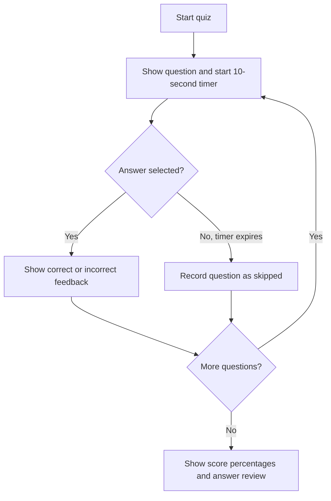

<div align="center">
  

  <h1>ReactQuiz</h1>

  <p>A colorful, timed quiz for testing your knowledge of React fundamentals.</p>

  <p>
    
    
    
  </p>
</div>

---

## ✨ About the project

ReactQuiz is a small, single-page quiz app built with React and Vite. Answer seven multiple-choice questions about React, race the per-question timer, and review your results when you're done. The interface gives immediate visual feedback for answers and summarizes correct, incorrect, and skipped questions.

## 🎯 Features

- **Seven React questions** covering components, JSX, hooks, state, and rendering.
- **Shuffled answer choices** for each question.
- **10-second timer** for every question; unanswered questions are automatically skipped.
- **Answer feedback** that highlights a selected answer as correct or incorrect before continuing.
- **Results summary** with percentages and a question-by-question answer review.
- **Guided quiz flow** with a progress indicator and skip action.
- **No account or backend required** — the quiz runs entirely in your browser.

## 🧭 How it works



## 🚀 Get started

### Requirements

- [Node.js](https://nodejs.org/) (an active LTS release recommended)
- npm (included with Node.js)

### Install and run

```bash
git clone https://github.com/Anirban1704/quiz-app.git
cd quiz-app
npm install
npm run dev
```

Open the local address printed by Vite to play the quiz.

### Available commands

| Command | Description |
| --- | --- |
| `npm run dev` | Start the local Vite development server. |
| `npm run build` | Create an optimized production build in `dist/`. |
| `npm run preview` | Serve the production build locally. Run `npm run build` first. |
| `npm run lint` | Check JavaScript and JSX files with ESLint. |

## 🧩 Project structure

```text
.
├── public/                  # Public assets
├── src/
│   ├── assets/              # Quiz logo and completion artwork
│   ├── components/
│   │   ├── Answers.jsx      # Shuffled answer choices and selection states
│   │   ├── Header.jsx       # App branding
│   │   ├── Question.jsx     # Question, answer feedback, and timer wiring
│   │   ├── QuestionTimer.jsx # Countdown progress indicator
│   │   ├── Quiz.jsx         # Quiz state and question progression
│   │   └── Summary.jsx      # Final statistics and answer review
│   ├── App.jsx              # App composition
│   ├── index.css            # Global styles and quiz theme
│   ├── main.jsx             # React entry point
│   └── questions.js         # Quiz question data
├── index.html               # HTML entry point
├── package.json             # Scripts and dependencies
└── vite.config.js            # Vite configuration
```

## 🛠️ Built with

- [React 19](https://react.dev/) for the component-based interface and quiz state.
- [Vite](https://vite.dev/) for local development and production builds.
- Plain CSS for the dark, gradient-backed quiz interface.

## 📝 Customize the quiz

Edit the question list in [`src/questions.js`](./src/questions.js). Each question has an `id`, its prompt in `text`, and an `answers` array. The first answer in each array is treated as the correct answer by the current quiz and summary logic.

---

<div align="center">
  Made for learning React, one question at a time.
</div>
